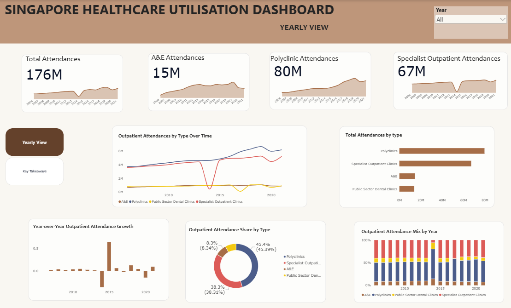
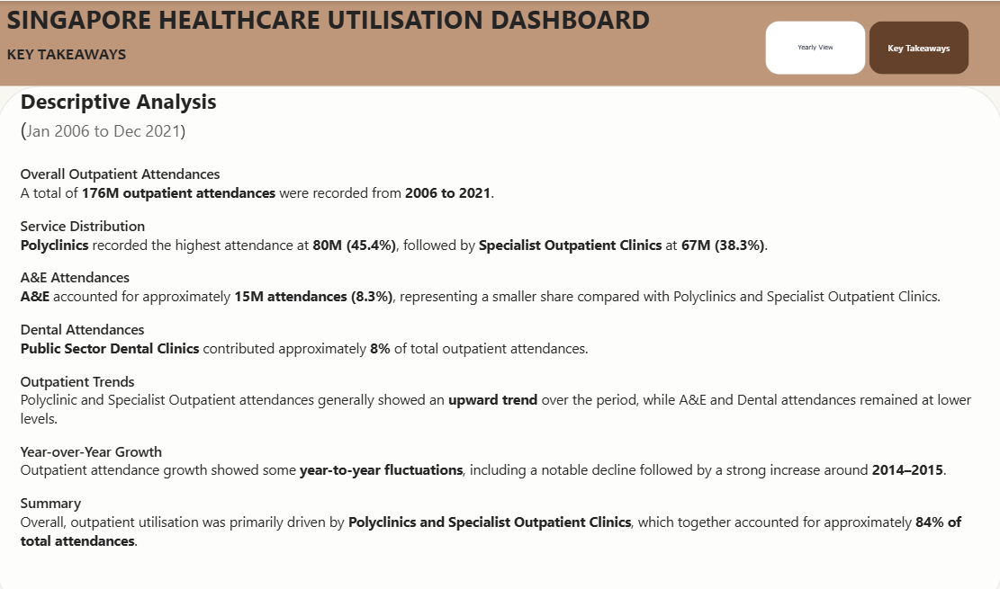

# powerbi-singapore-outpatient-attendances
# Singapore Healthcare Utilisation Dashboard

##  Project Overview

This project analyzes **Singapore outpatient attendances** from **January 2006 to December 2021** using Power BI.

The dashboard provides an overview of outpatient attendance trends, service distribution, year-over-year growth, and attendance mix across different healthcare service types.

##  Objectives

- Analyze outpatient attendance trends over time
- Compare attendance across healthcare service types
- Identify the largest contributors to outpatient utilisation
- Analyze year-over-year attendance growth
- Examine the attendance mix by year

##  Tools & Technologies

- **Power BI**
- **Power Query**
- **DAX**
- **Data.gov.sg**

##  Dataset

**Dataset:** Outpatient Attendances (A&E, SOCs, Polyclinics, Dental)

**Source:** [Singapore Government Data](https://data.gov.sg/datasets?query=Outpatient+Attendances)

**Period:** January 2006 – December 2021

The dataset covers four healthcare service categories:

- Polyclinics
- Specialist Outpatient Clinics
- Accident & Emergency (A&E)
- Public Sector Dental Clinics

##  Dashboard

The dashboard includes:

- Total Outpatient Attendances
- A&E Attendances
- Polyclinic Attendances
- Specialist Outpatient Attendances
- Outpatient Attendances by Type Over Time
- Total Attendances by Type
- Year-over-Year Outpatient Attendance Growth
- Outpatient Attendance Share by Type
- Outpatient Attendance Mix by Year

##  Dashboard Preview

## Yearly View

## Key Takeaway

##  Key Insights

- A total of **176M outpatient attendances** were recorded between 2006 and 2021.
- **Polyclinics** recorded the highest attendance at **80M (45.4%)**.
- **Specialist Outpatient Clinics** recorded **67M (38.3%)** of total attendances.
- **A&E** accounted for approximately **15M (8.3%)** of total attendances.
- **Public Sector Dental Clinics** contributed approximately **8%** of total outpatient attendances.
- Polyclinic and Specialist Outpatient attendances generally showed an **upward trend** over the period.
- Outpatient attendance growth showed **year-to-year fluctuations**, including a notable change around 2014–2015.

##  Skills Demonstrated

- Data cleaning and transformation using **Power Query**
- Data modelling
- DAX measure creation
- KPI development
- Time-series analysis
- Year-over-year analysis
- Data visualisation
- Dashboard design and data storytelling
### Files

* [Power BI Dashboard](./singapore-healthcare-utilization-analysis.pbix)

